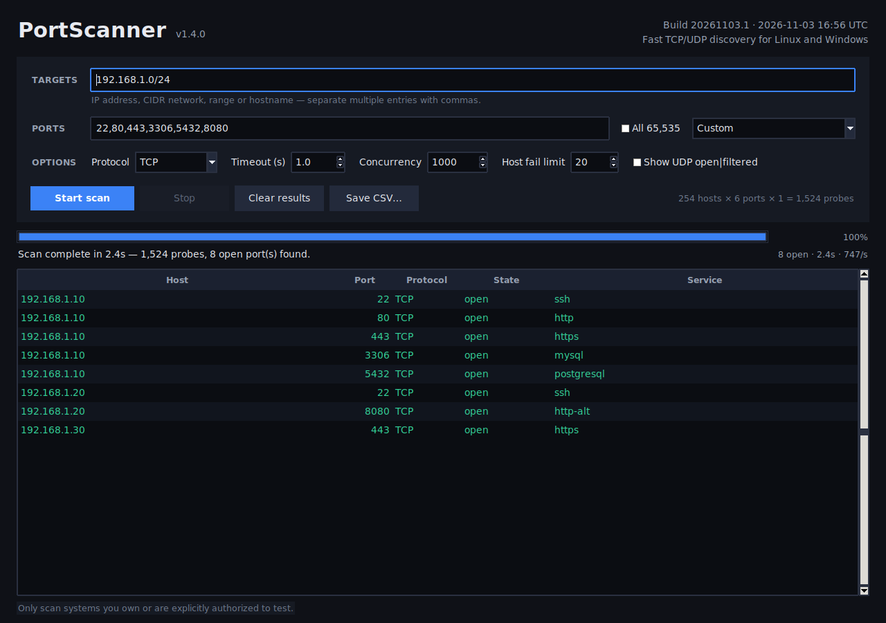
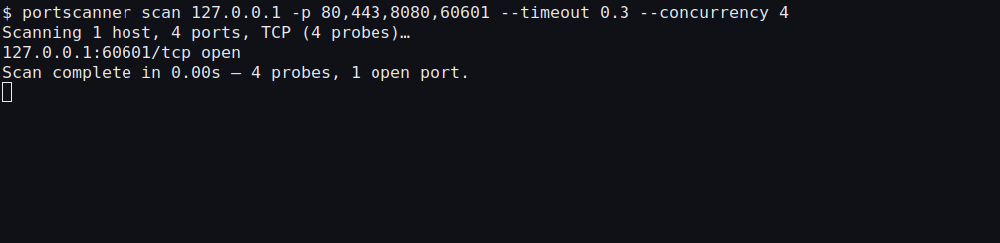

# PortScanner

Fast TCP/UDP port scanner for Linux and Windows 11 with a graphical interface.
No root privileges and no third-party runtime packages.

**Version 1.3.0** · Build 20261101.1 · 2026-11-01 11:14 UTC


[Quick start](#the-easy-way-to-get-started) ·
[Screenshots](#screenshots) ·
[How to use](#how-to-use) ·
[CLI](#headless-cli) ·
[Build from source](#build-from-source) ·
[Security](#security-and-dependency-updates)

## The easy way to get started

### Windows 11

1. Download **[PortScanner.exe](PortScanner.exe)** from this repository.
2. Double-click it. Python and Tkinter are **not** required.
3. Enter a target such as `127.0.0.1` or `192.168.1.10`, keep ports
   `22,80,443`, and press **Start scan**.

Windows SmartScreen may warn because the executable is unsigned. If you want
to verify it first, compare its hash with `SHA256SUMS`.

### Linux

If Python 3.11+, Tkinter, and `make` are already installed:

```bash
git clone https://github.com/RogerBergling/PortScanner.git
cd PortScanner
make build
./portscanner
```

Or download **[portscanner](portscanner)**, make it executable, and run it:

```bash
chmod +x portscanner
./portscanner
```

If Tkinter is missing:

```bash
# Debian / Ubuntu
sudo apt install python3-tk

# Fedora
sudo dnf install python3-tkinter

# Arch
sudo pacman -S tk
```

### First scan

1. **Targets:** `127.0.0.1` for a local test, or an address you are authorized
   to scan.
2. **Ports:** start with `22,80,443` or the **Common ports** preset.
3. Press **Start scan** and watch results appear live.
4. Use **Save CSV…** to keep the results.

### First scan from the command line

```bash
# Linux
./portscanner scan 127.0.0.1 -p 22,80,443

# Windows
.\PortScannerCLI.exe scan 127.0.0.1 -p 22,80,443
```

> Only scan systems you own or are explicitly authorized to test. Unauthorized
> port scanning may be illegal.

## Screenshots



*GUI with sample TCP results.*



*Headless CLI scan with text output.*

## Features

- Single IPs, CIDR networks, address ranges, hostnames, or a mixture
  (for example `192.168.1.0/24, 10.0.0.5-10`, `example.com`)
- TCP, UDP, or both at the same time
- Custom port lists and ranges, "common ports", "web servers",
  "well-known" and all 65,535 ports
- High concurrency (up to 5,000 probes in flight) with configurable timeout
- Live progress, scan rate, open-port counter and sortable result table
- Copy selected `host:port/protocol` entries with `Ctrl+C`, export to CSV
- Headless `scan` mode with text, CSV, or JSON output and automation exit codes
- Settings are remembered between runs
- Version, build number, and build date/time shown in the GUI and CLI

## How to use

1. **Targets** — enter an IP address, network, range or hostname. Separate
   multiple entries with commas or spaces:
   - `192.168.1.10`
   - `192.168.1.0/24` (network and broadcast addresses are skipped)
   - `10.0.0.5-10.0.0.25` or `10.0.0.5-25`
   - `example.com`
2. **Ports** — type a list (`22,80,443`), ranges (`1-1024`), use a preset, or
   tick **All 65,535**.
3. **Protocol** — choose **TCP**, **UDP**, or **TCP + UDP**.
4. Adjust **Timeout** and **Concurrency** if needed and press **Start scan**.
5. Open ports are listed while the scan runs. Use **Save CSV…** afterwards.

Keyboard shortcuts: `Enter` starts a scan, `Esc` stops it, `Ctrl+C` copies the
selected `host:port/protocol` entries.

### UDP scans

UDP has no handshake, so a UDP scan sends a small probe and waits for a reply:

- **open** — the service answered
- **open|filtered** — no answer before the timeout (enable
  *Show UDP open|filtered* to include these rows)

A UDP scan is naturally slower and less definitive than a TCP scan. A timeout
of 1 second or more is recommended.

### Large scans

The GUI warns before starting more than 2,000,000 probes. A `/24` with all
65,535 ports and both protocols is over 33 million probes and can take hours.
For quick results, start with the **Common ports** preset.

## Headless CLI

The GUI can be bypassed for scripts, servers, and CI. On Windows, use
**[PortScannerCLI.exe](PortScannerCLI.exe)**.

```bash
# Linux
portscanner scan 192.168.1.10 -p 22,80,443
portscanner scan 192.168.1.0/24 --ports common --format json
portscanner scan example.com --protocol both --show-filtered

# Windows
.\PortScannerCLI.exe scan 192.168.1.10 -p 22,80,443
.\PortScannerCLI.exe scan example.com --format json -o results.json
```

Common options:

- `-p/--ports` — port list, range, or preset keyword (default: `common`)
- `--all-ports` — scan all 65,535 ports
- `--protocol tcp|udp|both`
- `--timeout SECONDS`
- `--concurrency N` (1-5000)
- `--show-filtered` — include UDP `open|filtered`
- `--format text|csv|json`
- `-o/--output FILE`
- `--fail-on-open` — exit with status 1 when an open port is found
- `--quiet`
- `--yes` — allow scans over 2,000,000 probes

Exit codes: `0` success, `1` findings or scan failure, `2` usage/validation
error, `130` interrupted. Run `portscanner scan --help` for the full reference.

## Troubleshooting

**Windows SmartScreen blocked the app.** The executable is unsigned. Verify
the SHA-256 hash against `SHA256SUMS`, then choose the option to run it anyway
if you trust the source.

**`ModuleNotFoundError: No module named 'tkinter'`.** Install the Tkinter
package for your distribution; see the Linux instructions above.

**“No graphical display found.”** Start the app from a desktop session with
`DISPLAY` or `WAYLAND_DISPLAY` set, or use `portscanner scan` for headless use.

**A scan shows fewer open ports than expected.** Connect scans depend on
firewall rules, routing, and the timeout. Try a longer timeout or a different
network path.

## Build from source

<details>
<summary><strong>Linux build, install, tests, and lint</strong></summary>

Requirements: Python 3.11+ with Tkinter.

```bash
make build       # creates ./portscanner
./portscanner
```

Install system-wide:

```bash
sudo make install          # /usr/local/bin/portscanner
# or a custom prefix:
sudo make install PREFIX=/usr
```

Run tests and lint:

```bash
make test
make lint      # requires the tools in requirements-dev.txt
```

The tests use only the Python standard library and do not require a display.

</details>

<details>
<summary><strong>Build the Windows executables</strong></summary>

The checked-in Windows executables are self-contained 64-bit builds produced
with Python **3.14.10** and the pinned build dependencies in
`requirements-build.txt`.

```powershell
py -3.14 -m pip install -r requirements-build.txt

py -3.14 -m PyInstaller --noconfirm --clean --onefile --windowed `
  --name PortScanner --paths src --specpath build packaging/windows_launcher.py

py -3.14 -m PyInstaller --noconfirm --clean --onefile --console `
  --name PortScannerCLI --paths src --specpath build packaging/windows_cli_launcher.py
```

The [Windows build workflow](.github/workflows/windows-build.yml) runs the test
suite, audits build dependencies with `pip-audit`, and publishes both
executables.

</details>

## Notes

- The scanner performs TCP connect scans and connected UDP probes. It does not
  require root and does not send raw packets or SYN scans.
- Scans are limited to 65,536 targets per run to keep the interface usable.
- Settings are stored in `$XDG_CONFIG_HOME/portscanner/config.json`
  (default: `~/.config/portscanner/config.json`) on Linux and in
  `%APPDATA%\portscanner\config.json` on Windows.
- Only scan systems you own or are explicitly authorized to test.

## Security and dependency updates

- No third-party Python runtime dependencies; only the standard library and
  Tkinter.
- Both Windows executables bundle a current, patched Python runtime.
- Build dependencies are pinned; CI runs `pip-audit`, Ruff, and CodeQL.
- Dependabot checks GitHub Actions and Python build dependencies weekly.
- GitHub Actions are pinned to immutable commit SHAs.
- Configuration is versioned, validated, and written atomically.

See [SECURITY.md](SECURITY.md) for vulnerability reporting and
[docs/ENTERPRISE.md](docs/ENTERPRISE.md) for deployment guidance.

## Governance and assurance

- [MIT license](LICENSE)
- [Security policy](SECURITY.md)
- [Contributing guide](CONTRIBUTING.md)
- [Changelog](CHANGELOG.md)
- [Architecture and trust boundaries](docs/ARCHITECTURE.md)
- [Enterprise deployment and assurance](docs/ENTERPRISE.md)
- [Third-party notices](THIRD-PARTY-NOTICES.md)

PortScanner is released under the MIT license.

## Project layout

```text
src/portscanner/
  app.py       Tkinter interface and result handling
  build_info.py  version, build number, and build timestamp
  cli.py       headless scan command and output formats
  config.py    validated, atomic application settings
  engine.py    asyncio TCP/UDP scan engine
  ports.py     port parsing and presets
  targets.py   target expansion (IP, CIDR, ranges, DNS)
packaging/
  make_screenshots.py      reproducible README screenshot capture
  windows_launcher.py      PyInstaller entry point for PortScanner.exe
  windows_cli_launcher.py  PyInstaller entry point for PortScannerCLI.exe
docs/          architecture and enterprise guidance
  screenshots/ GUI and CLI images used by this README
tests/         unit and integration tests
LICENSE        MIT license
.github/       CI, CodeQL, Dependabot, and Windows build workflows
SECURITY.md        vulnerability disclosure and support policy
CONTRIBUTING.md    development and release workflow
CHANGELOG.md       release history
THIRD-PARTY-NOTICES.md  runtime and build component notices
requirements-build.txt  pinned PyInstaller build dependency
requirements-dev.txt    pinned pip-audit and Ruff tooling
pyproject.toml          Ruff configuration
SHA256SUMS     checksums for the committed executables
Makefile       build, test, install
```
